# Staff Engineering Podcast Companion: Revised Master Technical Reference & Study Guide

> **How to use this companion:** Read a section alongside the podcast, redraw its diagram, and answer its failure-mode questions without looking. All named architectures, SLO targets, timings, throughput figures, and ADR numbers below are **illustrative unless explicitly labeled verified**. They are not assertions about NuORDER's production deployment. Examples that combine AWS and GCP are teaching scenarios, not a claim that these services are deployed together.
>
> **Evidence discipline:** A system-design hypothesis is not a production measurement. Label assumptions, measure baselines, and record the evidence needed to validate them.

## 1. System Design & Architectural Leadership

Architectural leadership at the Senior+ and Staff level requires establishing systemic invariants, operational boundaries, and data contracts before writing code. Staff engineers evaluate cross-team alignment, capacity trade-offs, failure domains, and long-term maintainability, contrasting with Senior implementations that focus primarily on component-level correctness.

### 1.1 Requirements, Invariants, Capacity, and Trade-Offs

#### 1.1.1 SLA/SLO/SLI Definitions and Capacity Assumptions
Systemic reliability begins with defining measurable operational boundaries:
*   **Service Level Indicator (SLI)**: A quantifiable metric observing system behavior in real time, such as p99 HTTP latency, error rate, or queue consumer lag.
*   **Service Level Objective (SLO)**: A target threshold for an SLI over a rolling window (e.g., 99.9% of `/pull` stream responses delivered in <200ms over 30 days).
*   **Service Level Agreement (SLA)**: A formal contract specifying financial or operational consequences if SLO targets are breached.

When sizing systems, sizing calculations must account for peak multipliers, working set memory, network bandwidth, and storage growth over a multi-year retention window:

*   **Peak Throughput Estimation**:
    $$\text{Peak RPS} = \left( \frac{\text{Daily Active Users (DAU)} \times \text{Requests/User/Day}}{86,400} \right) \times \text{Peak Multiplier}$$
    For a platform with 1,000,000 DAU, each issuing 50 requests/day, with a $5\times$ peak traffic spike:
    $$\text{Average RPS} = \frac{1,000,000 \times 50}{86,400} \approx 578.7 \text{ RPS}$$
    $$\text{Peak RPS} = 578.7 \times 5 \approx 2,893.5 \text{ RPS}$$

*   **Network Ingress/Egress Bandwidth**:
    $$\text{Bandwidth (Gbps)} = \frac{\text{Peak RPS} \times \text{Average Payload Size (Bytes)} \times 8}{10^9}$$
    With a 50 KB payload size at peak RPS:
    $$\text{Bandwidth} = \frac{2,893.5 \times 50,000 \times 8}{10^9} \approx 1.157 \text{ Gbps}$$

*   **Storage Accumulation Rate**:
    $$\text{Storage/Year} = \text{Daily Ingestion} \times 365 \times \text{Replication Overhead}$$
    At 500 GB raw ingestion per day with 3x replication:
    $$\text{Storage/Year} = 0.5 \text{ TB} \times 365 \times 3 = 547.5 \text{ TB/year}$$

#### 1.1.2 Consistency Models and Distributed Primitives
System trade-offs require matching business domain invariants to consistency models:
*   **Linearizability**: Operations appear atomic in an order consistent with real-time precedence. It does not require a global physical clock. Some inventory and payment workflows benefit from linearizable operations, but business correctness can also be achieved with conditional writes, serializable transactions, reservations, or reconciliation depending on the invariants.
*   **Sequential Consistency**: Operations take effect in a valid global order that respects per-process program order, without enforcing absolute real-time timestamps.
*   **Causal Consistency**: Guarantees that operations causally related by a dependency graph are observed in the same order across all replicas, while concurrent operations may be observed in different orders.
*   **Eventual Consistency**: Replicas converge to an identical state over time assuming no new updates, accepting transient read stale-ness in exchange for low write latency and multi-region partition tolerance (PACELC theorem: If Partitioned, choose Availability vs Consistency; Else, choose Latency vs Consistency).

#### 1.1.3 Architectural Mechanisms: Caching, Sharding, Load Balancing, and Backpressure
Scale boundaries require specific coordination patterns:
*   **Cache Invalidation Strategies**: Cache-aside relies on application updates to delete or refresh keys upon write; write-through updates cache and database synchronously; write-behind queues database writes asynchronously via an in-memory buffer, risking data loss on process crashes.
*   **Sharding and Hot-Key Mitigation**: Sharding distributes rows by a partition key. Hash partitioning ensures uniform distribution but degrades range queries. Range partitioning allows efficient scans but creates temporal hot spots. Salting or striping hot partition keys (e.g., `item_id#stripe_N` where $N \in [0, 9]$) divides write contention across $N$ physical shards.
*   **Backpressure and Admission Control**: When downstream services hit saturation, upstream producers must enforce backpressure through bounded queues, token bucket rate limiting, circuit breakers, and load shedding (returning HTTP 429 or 503) to prevent cascading worker thread pool exhaustion.

---

### 1.2 System Design Case Studies

#### 1.2.1 Case Study 1: Collaborative Assortment Editing with Operational Transformation (OT) & Streaming `/pull`

##### Problem & Business Invariants
A multi-tenant retail assortment platform allows hundreds of concurrent merchandisers to edit large assortment grids (100,000+ items across store clusters). Operations must guarantee strong convergence (all clients see identical cell state), server-enforced validation, no silently lost acknowledged edits, and low-latency update distribution without server memory exhaustion.

##### Data Flow & System Topology
**Illustrative architecture:** The application could use Operational Transformation (OT) with a long-lived `/pull` server-streaming HTTP transport; verify actual storage, buffer, and event transport before treating this diagram as an as-built system. Client edit ops (`Insert`, `Delete`, `Retain`) pass to an OT Engine that transforms ops against concurrent server versions before committing to persistent storage and broadcasting changes downstream.

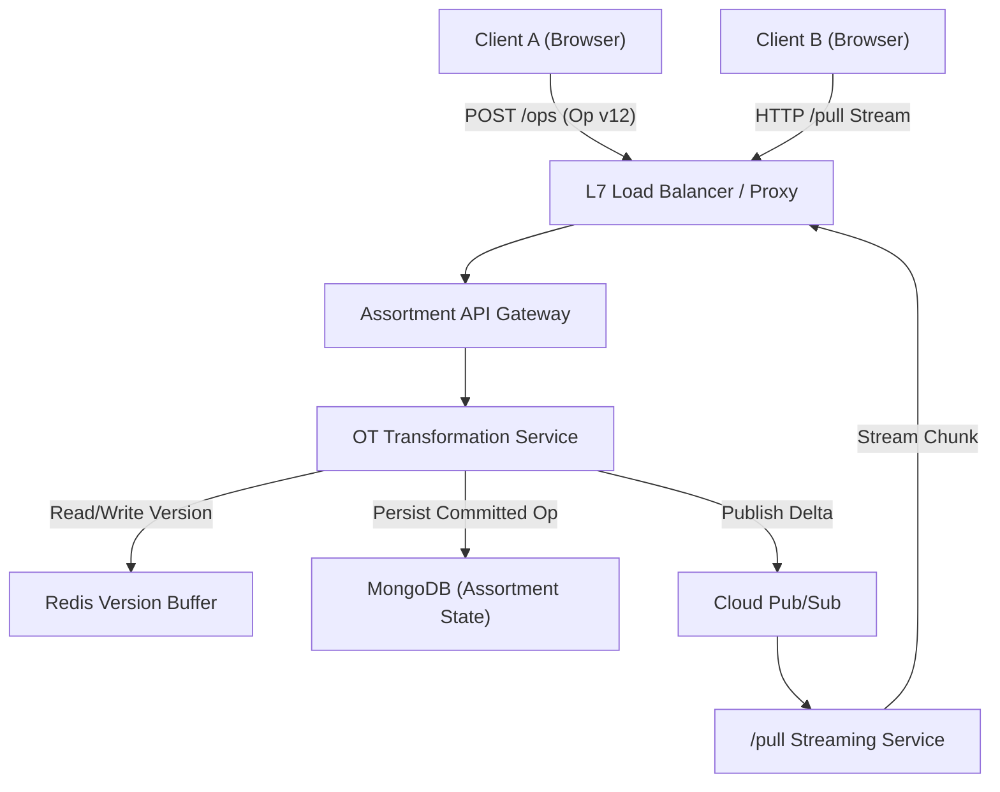

##### Deep Mechanism Analysis
1.  **Operation Transformation Pipeline**:
    When Client A submits operation $O_a$ generated at client version $v_k$, while the server has advanced to version $v_{k+2}$ due to committed operations $O_1$ and $O_2$, the server OT engine transforms $O_a$ against $O_1$ and $O_2$ ($O'_a = T(T(O_a, O_1), O_2)$) before applying $O'_a$ to state version $v_{k+2}$, advancing the document to $v_{k+3}$.
2.  **Streaming Transport Boundaries**:
    **Illustrative transport assumption, not verified implementation:** An HTTP/1.1 streaming response might use chunked transfer encoding and periodic application heartbeats. HTTP/2 streaming uses DATA frames instead. Heartbeat intervals, framing, and proxy behavior must be verified from deployment configuration and traces.

##### Failure Modes & Bottlenecks
*   **Proxy Buffer Exhaustion**: Intermediate proxies with response buffering enabled stall `/pull` stream chunks until the buffer size (e.g., 4 KB or 16 KB) is reached, leading to client stall perception. For NGINX configurations that honor it, `X-Accel-Buffering: no` can disable buffering; other proxies require their own settings and tests.
*   **Version Divergence On Reconnect**: If a client disconnects during network instability, it re-establishes `/pull` passing its last acknowledged operation version $v_{ack}$. If $v_{server} - v_{ack} > \text{MaxBufferLength}$, the server rejects delta replay and triggers a full state snapshot hydration.

---

#### 1.2.2 Case Study 2: Asynchronous Export / Validation Pipeline

##### Problem & Business Invariants
Merchandisers execute complex validation formulas (e.g., gross margin rules, cross-category stock checks) over millions of row combinations and export results to external formats (CSV, XLSX, PDF). The system must isolate heavy computational workloads from real-time collaborative editing, enforce per-tenant resource limits, and provide execution durability across process restarts.

##### Data Flow & System Topology
Export and validation requests are accepted synchronously, assigned a tracking job ID, and dispatched asynchronously through distributed queue topologies.

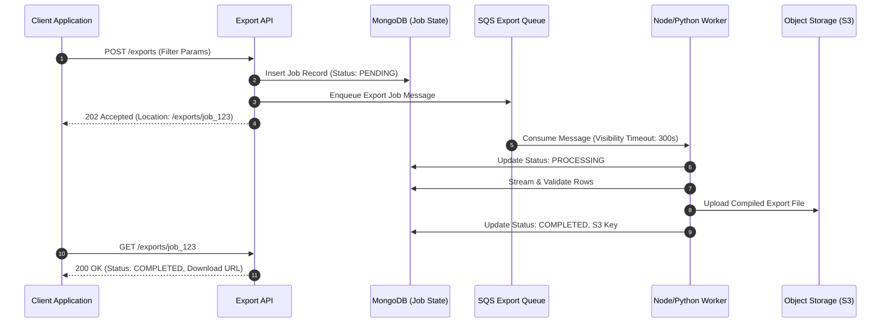

##### Deep Mechanism Analysis
*   **Job Isolation & Fair Queueing**: Export jobs are categorized into priority classes. High-volume tenants are governed via per-tenant queue concurrency limits using SQS Message Group IDs (FIFO queues) or token buckets in Redis to prevent a single tenant from starving global worker pools.
*   **Stream Processing & Memory Boundaries**: Workers process data using Node.js or Python cursor streams directly from storage to temporary local disk or multi-part S3 upload streams, maintaining memory usage below 256 MB regardless of export size.

##### Migration, Rollback & Success Metrics
*   **Rollback Strategy**: If a formula execution engine update generates malformed exports, feature flags instantly divert queue consumers to the legacy worker container image.
*   **Success Metrics**: Job completion rate ($>99.95\%$), p95 execution latency, queue consumer lag, and S3 upload error rate.

---

#### 1.2.3 Case Study 3: Versioned Schema / Formula Platform

##### Problem & Business Invariants
Assortments require dynamic, tenant-defined schemas and formula fields (e.g., custom price rollups, margin projections). Schema modifications must be versioned, immutable once committed to historical close periods, and evaluated deterministically without allowing arbitrary code execution.

##### System Architecture & Lifecycle
Schema definitions are decoupled from row data using explicit version references.

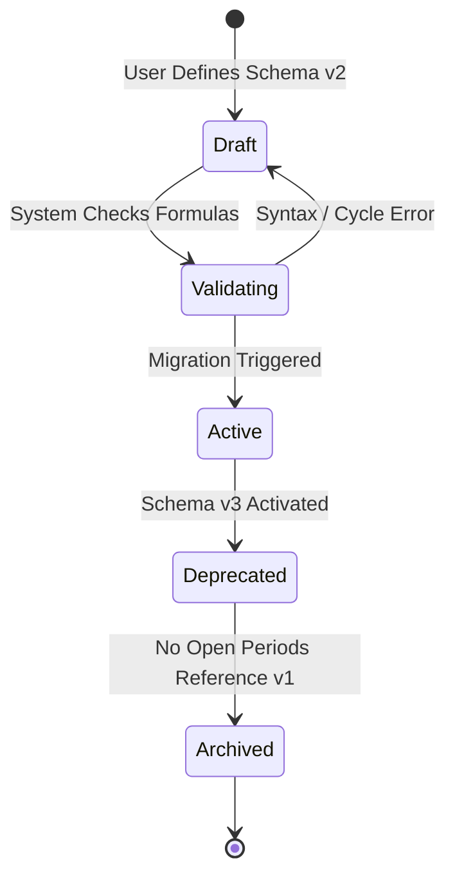

##### Evaluation Engine & Sandbox Safety
Formulas are parsed into Abstract Syntax Trees (ASTs) using a strict, sandboxed grammar. Re-evaluations execute inside stateless worker pools or Web Workers using compiled AST execution graphs.

---

### 1.3 Pre-Code Staff Leadership

Prior to writing code, a Staff Engineer establishes technical alignment through structured architectural governance:

| Leadership Phase | Primary Deliverables | Key Questions Answered |
| :--- | :--- | :--- |
| **1. Requirements & Boundary Definition** | Architectural Decision Record (ADR), Functional vs Non-Functional matrix | What system invariants must never be violated? What are the explicit latency, throughput, and durability bounds? |
| **2. Domain & Data Contract Modeling** | API Schemas (OpenAPI/Protobuf), Event Schemas, Entity-Relationship Maps | Which service owns authoritativeness for each field? Are interfaces backward compatible? |
| **3. Operational & Failure Planning** | Security Boundary Model, Capacity Model, Runbooks, Disaster Recovery Playbooks | What happens when a dependency times out or fails? How do we scale under a 10x burst? |
| **4. Alignment & Governance** | Cross-Team Design Review, RFC Process, Success Criteria Metrics | Who owns post-launch metrics? What cuts can be safely made if deadlines compress? |

---

## 2. Backend Distributed Correctness & Messaging Topologies

### 2.1 Fault Tolerance, Isolation, and Concurrency Controls

#### 2.1.1 Ambiguous Timeout Resolution
In a distributed network, a request timeout does **not** indicate that the downstream operation failed. Network timeouts represent an *uncertain* outcome:
1.  The request failed to reach the server.
2.  The server processed the operation, but the response was dropped or delayed.
3.  The server crashed during execution.

Blindly retrying a timed-out non-idempotent operation risks double-processing side effects (e.g., charging a payment twice or posting duplicate journal entries). Retries must be bounded using exponential backoff with full jitter to avoid retry storms:

$$\text{Sleep Delay} = \text{random}(0, \min(\text{MaxBackoff}, \text{InitialBase} \times 2^{\text{Attempt}}))$$

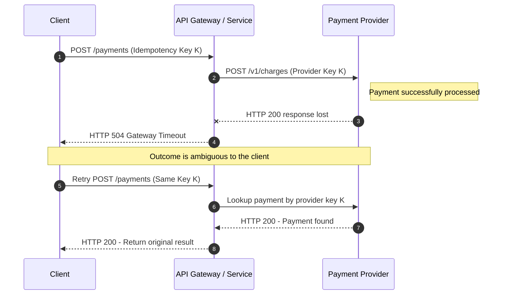

#### 2.1.2 Transactional Outbox Pattern
To prevent inconsistencies between database updates and event publishing (e.g., database commits successfully, but the application crashes before publishing the message to Kafka/SQS), systems use the Transactional Outbox pattern.

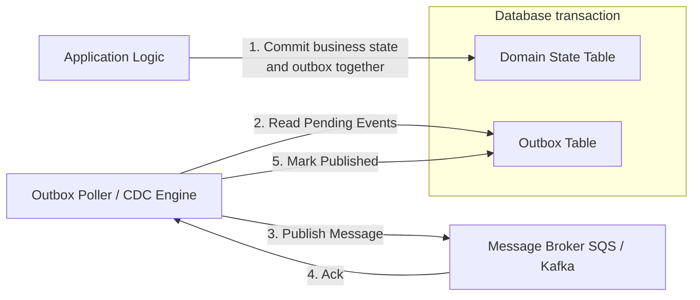

#### 2.1.3 ACID Isolation Levels and Concurrency Anomalies
Relational and document stores provide different levels of isolation, exposing applications to specific concurrency anomalies:

| Isolation Level | Dirty Read | Non-Repeatable Read | Phantom Read | Lost Update | Write Skew |
| :--- | :--- | :--- | :--- | :--- | :--- |
| **Read Uncommitted** | Allowed | Allowed | Allowed | Allowed | Allowed |
| **Read Committed** | Prevented | Allowed | Allowed | Allowed | Allowed |
| **Repeatable Read** | Prevented | Prevented | Prevented (in Postgres) | Allowed (some DBs) | Allowed |
| **Snapshot Isolation**| Prevented | Prevented | Prevented | Prevented | Allowed |
| **Serializable** | Prevented | Prevented | Prevented | Prevented | Prevented |

##### Concurrency Control Code Implementations

*   **Optimistic Concurrency Control (OCC)** (MongoDB / SQL): Uses version checks to prevent lost updates without holding locks.

```typescript
// TypeScript OCC Implementation in MongoDB
interface AccountDocument {
  _id: string;
  balanceMinor: number;
  version: number;
}

async function updateBalanceOCC(
  accountId: string, 
  amountMinor: number, 
  expectedVersion: number
): Promise<boolean> {
  const result = await db.collection<AccountDocument>('accounts').updateOne(
    { _id: accountId, version: expectedVersion },
    { 
      $inc: { balanceMinor: amountMinor },
      $set: { version: expectedVersion + 1 } 
    }
  );
  return result.modifiedCount === 1; // False indicates concurrent modification conflict
}
```

*   **Pessimistic Concurrency Control (PCC)** (PostgreSQL): Locks rows explicitly to force sequential execution.

```sql
-- PostgreSQL Pessimistic Locking Implementation
BEGIN;
SELECT id, balance_minor 
FROM accounts 
WHERE id = 'acc_123' 
FOR UPDATE; -- Blocks concurrent transactions reading this row FOR UPDATE

UPDATE accounts 
SET balance_minor = balance_minor + 5000 
WHERE id = 'acc_123';

COMMIT;
```

---

### 2.2 Financial Correctness, Ledgers, and Reconciliation

Financial systems require strict auditability and invariant preservation. Financial balances are never stored solely as mutable scalar values; they are derived from immutable ledgers.

#### 2.2.1 Immutable Double-Entry Ledger Invariants
In double-entry bookkeeping, every financial event consists of a balanced journal entry containing equal debits and credits:

$$\sum \text{Debits} = \sum \text{Credits}$$

```sql
-- Relational Schema Enforcing Ledger Invariants
CREATE TABLE journal_entries (
    entry_id UUID PRIMARY KEY,
    tenant_id VARCHAR(64) NOT NULL,
    posted_at TIMESTAMPTZ NOT NULL DEFAULT NOW(),
    description TEXT NOT NULL
);

CREATE TABLE ledger_lines (
    line_id UUID PRIMARY KEY,
    entry_id UUID NOT NULL REFERENCES journal_entries(entry_id),
    account_id VARCHAR(64) NOT NULL,
    direction VARCHAR(6) CHECK (direction IN ('DEBIT', 'CREDIT')),
    amount_minor BIGINT NOT NULL CHECK (amount_minor > 0),
    currency VARCHAR(3) NOT NULL
);

-- Invariant Enforcement View / Check
-- DIAGNOSTIC ONLY: a view does not enforce balance at commit time.
CREATE VIEW unbalance_check AS
SELECT 
    entry_id,
    SUM(CASE WHEN direction = 'DEBIT' THEN amount_minor ELSE 0 END) AS total_debit,
    SUM(CASE WHEN direction = 'CREDIT' THEN amount_minor ELSE 0 END) AS total_credit
FROM ledger_lines
GROUP BY entry_id
HAVING SUM(CASE WHEN direction = 'DEBIT' THEN amount_minor ELSE 0 END) != 
       SUM(CASE WHEN direction = 'CREDIT' THEN amount_minor ELSE 0 END);
```

#### 2.2.2 Payment State Machine & Lifecycle

*This is a simplified teaching model; real providers may separate capture, clearing, settlement, refunds, disputes, and reversals into independent resources.*
Financial state transitions must follow a strictly controlled state machine. An `UNKNOWN` operational outcome requires provider-status lookup, idempotent retry where supported, or reconciliation; it must not be treated as confirmed failure.

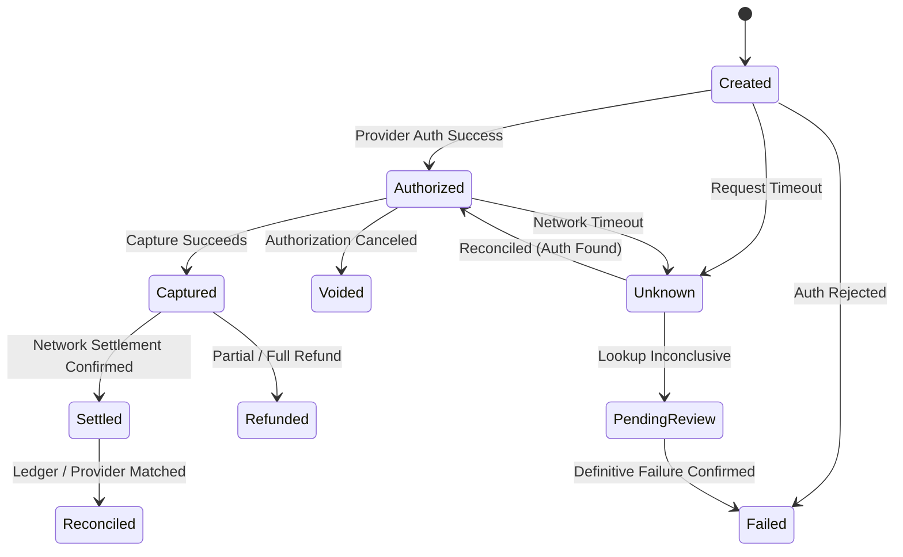

---

### 2.3 Messaging Topologies Compared

Choosing the correct messaging system depends on ordering requirements, consumer group scale, replay needs, and delivery semantics.

| Characteristic | AWS SQS | AWS SNS | AWS EventBridge | Apache Kafka | Google Cloud Pub/Sub |
| :--- | :--- | :--- | :--- | :--- | :--- |
| **Primary Pattern** | Point-to-point Task Queue | Pub/Sub Topic | Event Router / Bus | Partitioned Append Log | Global Pub/Sub |
| **Routing / Fan-Out** | Direct to Consumer | Broad Fan-Out | Content-Based Filtering | Consumer Group Partitions | Subscription-based |
| **Ordering Guarantees** | Best-effort (FIFO queue optional) | No ordering guarantees | No ordering guarantees | Strict within Partition | Per-ordering key |
| **Message Replay** | No (deleted on Ack) | No | No (Archiving optional) | Yes (Offset-based retention)| Yes (Seek to timestamp) |
| **Concurrency / Scaling** | Worker pool per queue | Unlimited subscribers | Rule-matched targets | Limited to Partition count | Dynamic auto-scaling |
| **Delivery Guarantee** | At-least-once | At-least-once | At-least-once | At-least-once (EOS optional)| At-least-once |

---

### 2.4 Zero-Downtime Database Migrations

Deploying database schema changes without taking downtime requires an **Expand-and-Contract** (Phase-based) migration pattern across multiple deployment cycles:

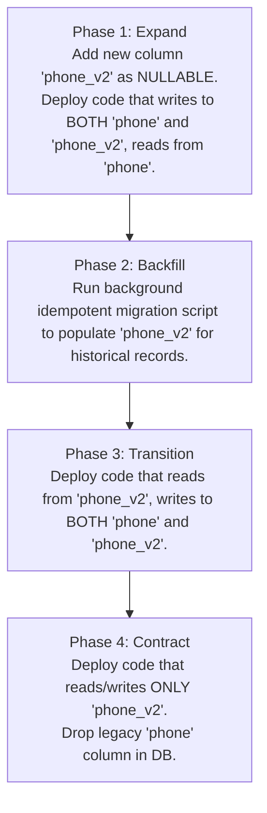


## 3. Deep Networking Protocols & Production Troubleshooting Playbook

### 3.1 Networking Stack Fundamentals

Modern application engineering requires understanding protocol semantics and failure guarantees across the full OSI/TCP-IP networking stack.

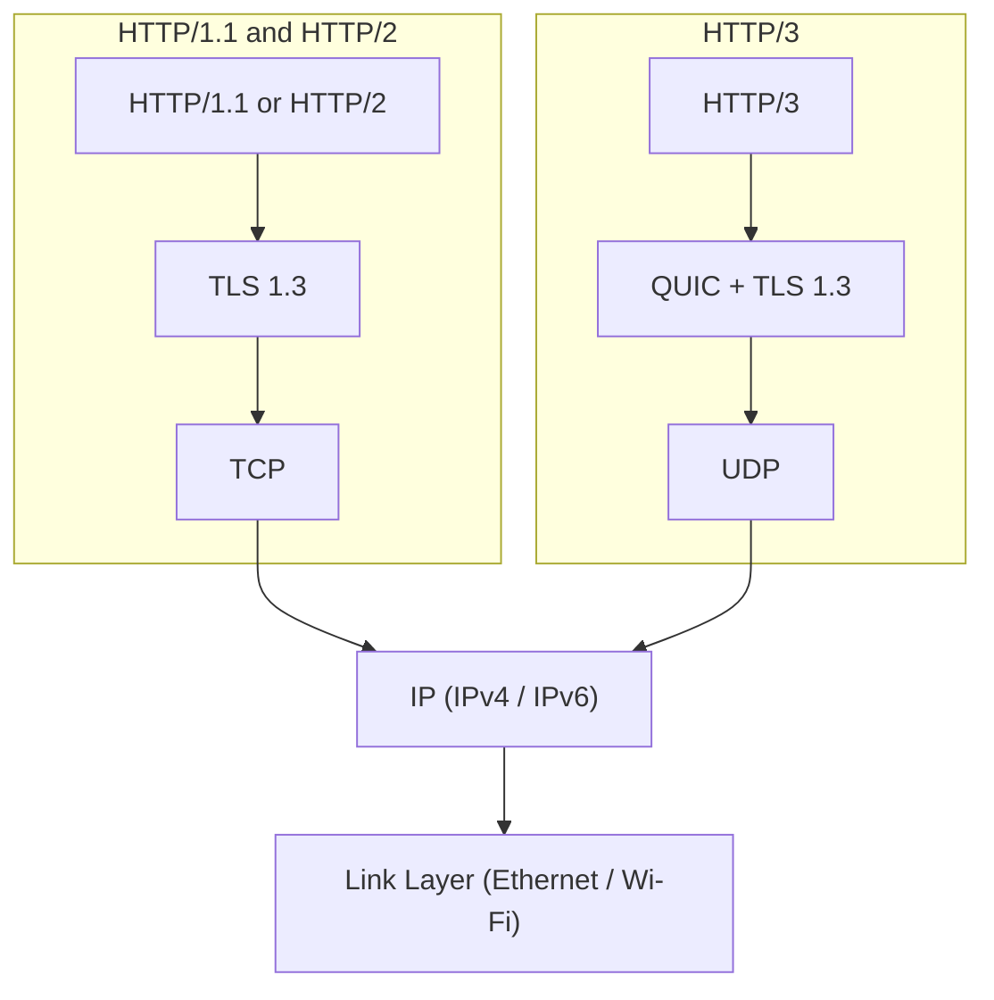

#### 3.1.1 Network Layer Mechanics & CIDR Arithmetic
*   **Classless Inter-Domain Routing (CIDR)**: Defines network prefix lengths. A `/24` prefix allocates 24 bits for the network and 8 bits for host addresses ($2^8 = 256$ total IPs; 254 usable after reserving network `.0` and broadcast `.255`). Cloud VPCs reserve additional IPs (e.g., AWS reserves 5 IPv4 addresses per subnet).
*   **Longest-Prefix Match**: Routers evaluate route tables by forwarding traffic to the most specific matching CIDR block. A route matching `10.42.16.0/20` takes precedence over `10.0.0.0/8` and `0.0.0.0/0`.
*   **Border Gateway Protocol (BGP)**: Inter-domain routing protocol path vector algorithm. AS (Autonomous System) networks exchange prefix reachability using attributes (`AS_PATH`, `LOCAL_PREF`, `MED`). BGP routing policy updates occur as prefixes propagate across independent networks.

#### 3.1.2 Transport Layer & TLS Mechanics
*   **TCP Connections**: Enforces reliable, ordered byte delivery via a 3-way handshake (`SYN` -> `SYN-ACK` -> `ACK`). Head-of-line (HOL) blocking occurs when a lost TCP segment halts processing of all subsequent multiplexed streams on that connection.
*   **HTTP/2 vs HTTP/3 (QUIC)**: HTTP/2 multiplexes multiple virtual streams over a single TCP connection, eliminating application-level HOL blocking but remaining susceptible to TCP transport HOL blocking. HTTP/3 runs over QUIC (UDP), embedding TLS 1.3 encryption directly into transport connections and providing independent stream delivery so loss affecting one stream need not block delivery on other streams. Congestion control is generally connection-wide, not per stream.
*   **Server Name Indication (SNI) & mTLS**: SNI supplies the requested target hostname in the cleartext TLS Client Hello frame, allowing reverse proxies to select the correct SSL/TLS certificate. Mutual TLS (mTLS) authenticates both client and server via X.509 certificates, establishing cryptographic identity boundaries for zero-trust microservice networks.

---

### 3.2 Production Incident Case Study: Stuck `/pull` Streams

#### Incident Scenario & Root Cause Analysis
Production clients report that collaborative editing grids freeze after ~60 seconds of inactivity. WebSockets or streaming `/pull` endpoints stop delivering cell updates, yet client connection metrics indicate an active TCP socket.

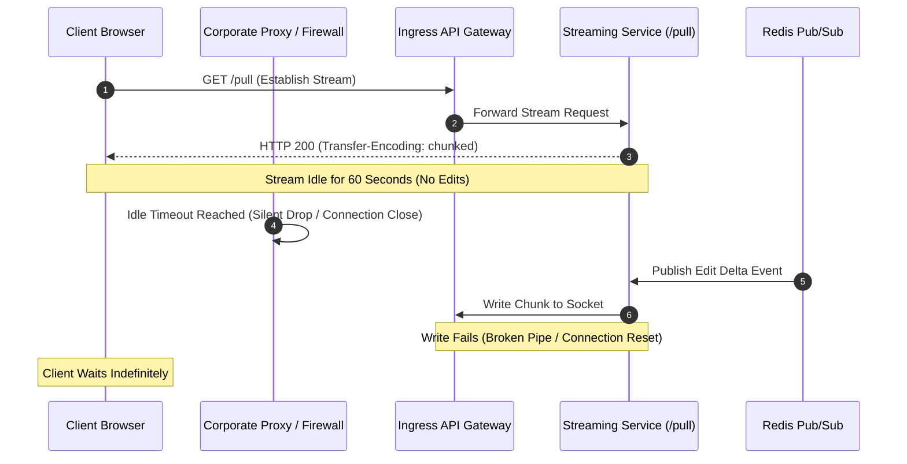

#### Diagnostic Hypothesis Matrix

| Layer | Hypothesis | Verification Method | Expected Finding if True | Mitigation |
| :--- | :--- | :--- | :--- | :--- |
| **L7 Proxy** | Reverse proxy is buffering responses | Inspect stream delivery behavior | Response chunks arrive in 4KB bursts instead of instantly | Set `X-Accel-Buffering: no` or flush proxy buffers |
| **L4 Transport**| Intermediate firewall idle connection drop | Trace active TCP connection state | No termination frame sent to client; TCP keepalives dropped | Emit application-level `\n` heartbeats every 15s |
| **Application**| Client event loop or promise stall | Chrome DevTools Performance Panel | Main thread long task (>50ms) blocking socket processing | Move stream parsing to Web Worker |

---

### 3.3 Diagnostic Decision Tree

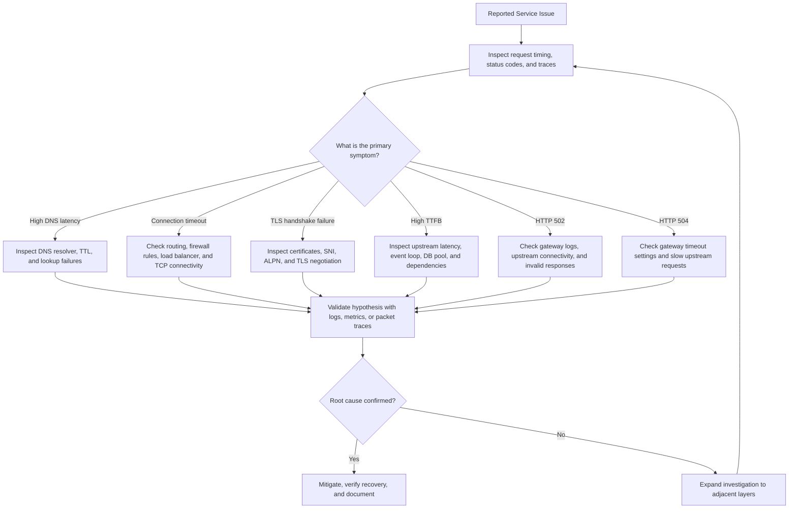


## 4. React Internal Mechanics & Senior Frontend Architecture

### 4.1 React Runtime Internals

React operates as a declarative UI runtime. Understanding internal scheduling guarantees is essential for building responsive applications under heavy computational loads.

#### 4.1.1 Fiber Reconciliation Engine
The Fiber architecture represents React work in units that support reconciliation, prioritization, and—in concurrent rendering—interruptible rendering. A Fiber holds bookkeeping for a component or host element; it is not itself a DOM node.

*   **Render Phase (Pure; Interruptible in Concurrent Rendering)**: React computes the new Fiber tree, determining structural changes (diffing). The engine can pause, interrupt, or discard this phase if high-priority browser events (e.g., user input) arrive. Render functions **must be pure side-effect-free functions**.
*   **Commit Phase (Synchronous for DOM mutations)**: React applies mutations to the actual DOM (`placement`, `update`, `deletion`) and executes lifecycle hooks (`useLayoutEffect`). This phase runs synchronously to prevent visual UI tearing.

#### 4.1.2 Hooks Mechanics & Captured State
*   **Stale Closures**: Asynchronous callbacks, timers, or effect closures capture variables from the specific render frame in which they were created. If state updates occur while a closure is pending, reading the closed-over variable returns stale snapshot data.

```tsx
// Incorrect: Stale Closure in Interval
function StaleCounter() {
  const [count, setCount] = useState(0);
  useEffect(() => {
    const id = setInterval(() => {
      setCount(count + 1); // Reads captured 'count' value (0) perpetually
    }, 1000);
    return () => clearInterval(id);
  }, []); // Missing 'count' dependency causes bug
  return <h1>{count}</h1>;
}

// Correct: Functional State Updates
function CorrectCounter() {
  const [count, setCount] = useState(0);
  useEffect(() => {
    const id = setInterval(() => {
      setCount(prev => prev + 1); // Passes updater function, bypassing stale closure
    }, 1000);
    return () => clearInterval(id);
  }, []);
  return <h1>{count}</h1>;
}
```

*   **Concurrent APIs**:
    *   `startTransition`: Marks state updates as non-urgent transitions, allowing user input to interrupt rendering of large UI updates.
    *   `useDeferredValue`: Defers updating a non-critical portion of the UI tree until urgent renders complete.
    *   `useSyncExternalStore`: Provides a subscription and stable-snapshot contract for React to coordinate external mutable state and avoid tearing. It does not make Worker communication or SQLite access thread-safe; an adapter must publish coherent snapshots.

---

### 4.2 Large Data Grid Architecture: AG Grid + SQLite-WASM + Web Worker

To keep main-thread interactions responsive while working with large assortment datasets, heavy data operations are offloaded from the main UI thread to a Web Worker running SQLite compiled to WebAssembly (WASM).

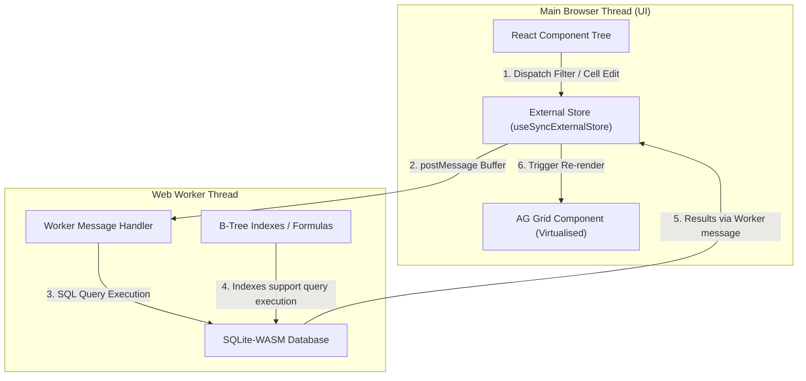

#### Message Communication & Memory Isolation
Main thread and Web Worker communicate via asynchronous message passing (`postMessage`). Transferable `ArrayBuffer` ownership can move between threads without copying its bytes, but serialization, allocations, and synchronization still cost time. `SharedArrayBuffer` permits shared memory only under appropriate cross-origin isolation and requires explicit synchronization.

---

### 4.3 State Ownership Taxonomy & MFE Contracts

Applications should partition state across a clear hierarchy based on lifecycle and ownership boundaries:

| State Category | Purpose & Ownership | Recommended Pattern |
| :--- | :--- | :--- |
| **Local Ephemeral UI** | Component-specific visual state (hover, modal open) | `useState`, `useReducer` |
| **URL State** | Navigable, shareable UI inputs (filters, active tab) | Router Query Params (`useSearchParams`) |
| **Shared Client State** | Cross-component workspace selections | `Context`, Zustand, Redux Toolkit |
| **Server State** | Asynchronous cached remote data | TanStack Query / RTK Query |
| **Local Offline State**| Heavy transactional edit drafts | SQLite-WASM in Web Worker |

#### Micro-Frontend (MFE) State Boundaries
Sharing a single global Redux store across independently deployed MFEs creates a distributed monolith, breaking deployment isolation. MFEs must communicate via explicit, versioned API contracts, custom DOM event buses (`window.dispatchEvent`), or lightweight shell-level state interfaces.


## 5. Governed AI-Native Engineering & Empirical SDLC

### 5.1 Empirical Research vs "Vibe Coding" Reality

While synthetic benchmarks (e.g., HumanEval) and short-term laboratory studies suggest software developers complete greenfield tasks ~55% faster with LLM assistance, empirical RCT studies conducted on mature production codebases reveal different operational dynamics:

*   **Task Completion Duration**: One METR randomized study of experienced developers working on familiar open-source repositories reported tasks taking about **19% longer** with AI tools in its specific 2025 setting. This is not a universal estimate for enterprise engineering, and the study does not establish that a lack of guardrails caused the slowdown.
*   **Plausible contributors to investigate (not proven causal decomposition of the RCT)**:
    1.  **Diff Review & Verification Burden**: Evaluating AI-generated code diffs over complex, multi-layered codebases requires high cognitive load to verify subtle edge cases.
    2.  **Architectural Alignment Friction**: LLMs tend to generate self-contained, verbose solutions that duplicate existing abstractions or violate project architectural standards.
    3.  **Hallucinated API Dependencies**: Models frequently introduce phantom utility functions or non-existent third-party library methods.

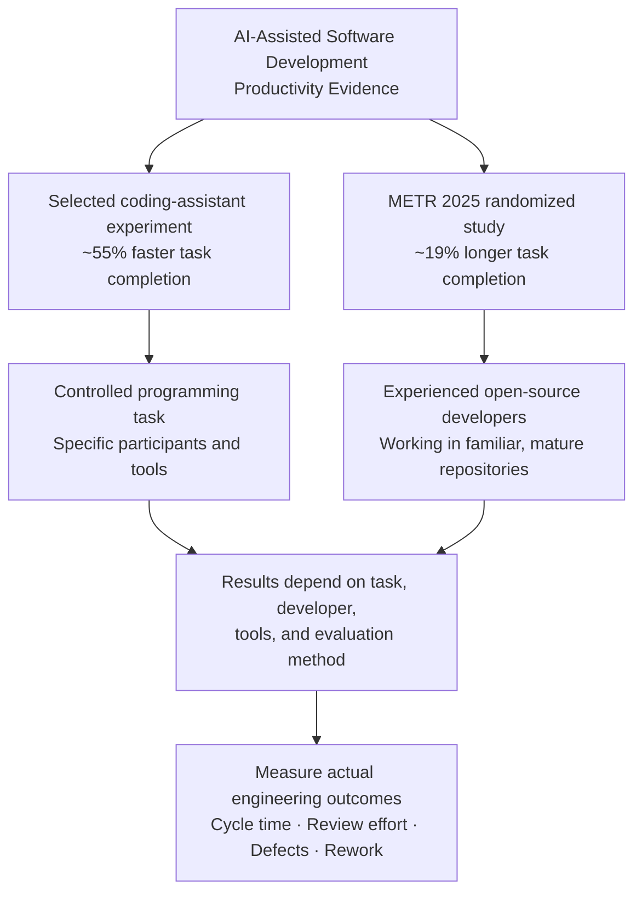

---

### 5.2 Governed AI Architecture & RAG Pipeline

To deploy AI safely into financial and accounting workflows, non-deterministic model outputs must be wrapped inside deterministic execution boundaries.

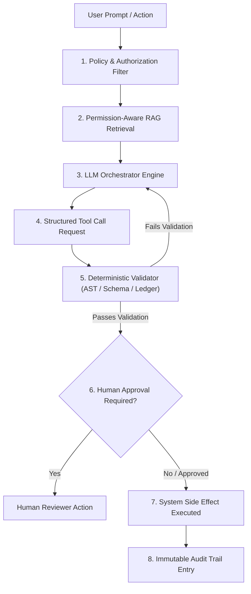

#### Production Guardrail Engineering
1.  **Deterministic Static Analysis Gates**: Every AI-generated commit or automated pull request must pass automated static analysis, strict TypeScript type checking, linter constraints, and unit test suites inside CI/CD pipelines before merge.
2.  **Permission-Aware RAG Retrieval**: Vector search must apply tenant, entity, and role-based ACL filter predicates directly to the retrieval query *before* vector index scanning, ensuring users cannot query or summarize documents outside their explicit authorization boundary.
3.  **Tool Call Allowlisting**: LLMs must interact with internal infrastructure solely through strongly typed, versioned function calls (e.g., Model Context Protocol / MCP tools). Direct generation or execution of un-sandboxed code is prohibited.


## 6. Communication, Delivery & Interview Leadership

Staff Engineers demonstrate leadership by structuring complex technical decisions, driving cross-team consensus, and communicating trade-offs clearly to executive stakeholders.

### 6.1 Staff Engineering Communication Frameworks

#### 6.1.1 Architecture Decision Record (ADR) Template
When proposing major architectural shifts (e.g., adopting micro-frontends or migrating persistence layers), document decisions using a formal ADR:

```markdown
# ADR-014: Client-Side SQLite-WASM for Assortment Rollup Processing

## Status: APPROVED
## Context
Assortment rollups over 100k+ items freeze the main UI thread during recalculation.
Server-side computation may introduce network latency on interactive edits; establish a measured baseline.

## Decision
We will offload calculation rollups to a Web Worker running SQLite-WASM.

## Consequences
### Hypotheses to validate (NOT measured results)
- Reduced main-thread blocking and interactive latency; benchmark before/after p50/p95/p99.
- Potentially reduced server-side compute, depending on which work moves client-side.
### Negative / Risks
- Additional WASM download/initialization and client memory pressure; measure actual size.
- Worker message sequencing, stale results, and client hardware variability.

## Mitigation
Lazy-load WASM binaries in background threads after initial UI render.
```

#### 6.1.2 Senior vs Staff Interview Response Comparisons

| Interview Topic | Senior Engineer Response | Staff Engineer Response |
| :--- | :--- | :--- |
| **Scaling a Storage Tier** | *"We should shard MongoDB by tenant_id and add Redis caching in front of reads to lower database load."* | *"We'll evaluate read/write access patterns first. If read traffic dominates, we'll implement read-replicas with bounded cache-aside invalidation. If write contention on specific tenants causes hot partitions, we'll stripe hot tenant keys across $N$ physical shards, evaluate the cost of cross-shard aggregations, and define tenant-level SLOs."* |
| **Handling API Timeouts** | *"If an API call times out, we should set up a retry loop with exponential backoff."* | *"A timeout is an uncertain outcome, not a failure. We must enforce client-supplied idempotency keys on every write, check downstream provider transaction status prior to issuing a retry, use a Transactional Outbox to prevent event-publish gaps, and route ambiguous cases to a reconciliation queue."* |
| **Adopting Generative AI** | *"We can use an LLM agent to automatically parse invoice PDFs and write entries directly to the ERP database."* | *"We will establish a governed AI pipeline where the LLM is restricted to proposing structured JSON tool calls. Inputs pass through permission-filtered RAG retrieval, outputs undergo deterministic ledger rule validation, and actual ERP side effects require explicit human approval and immutable audit logging."* |


## 6A. Architecture Decisions: Database Scaling, Service Boundaries, and Evidence

### 6A.1 Database, instance, node, partition, shard, replica

A **logical database** is the named data collection and its query/transaction interface; a **DBMS instance** is a running server process; a **node** is a compute/storage participant (VM, machine, or a database-specific logical member); and a **cluster** coordinates nodes. Multiple logical databases can share one node. One logical database can span many nodes. Managed services can decouple compute from storage, so inspect the actual topology before proposing scaling.

| Mechanism | What changes | Best initial use case | Trade-off / failure mode |
|---|---|---|---|
| Vertical scaling | More CPU/RAM/IOPS per node | Resource-bound workload with headroom | Hardware ceiling, larger failure domain |
| Index/query tuning | Less work per query | Slow plans, scans, sort spills | Write amplification, index memory/storage |
| Partitioning | Divides table into subsets, often by time | Pruning, retention, partition-local maintenance | Poor pruning; still same node bottleneck |
| Sharding | Distributes different key ranges/hash buckets across independently scalable resources | Storage/write capacity exceeds one node | Routing, hot keys, rebalancing, cross-shard joins/transactions |
| Replication | Copies data to additional nodes | Failover, read offload, locality | Replica lag, stale reads, failover consistency |
| Caching | Copies selected results near callers | Repeated expensive reads, latency | Invalidation, staleness, stampedes |

**Partitioning** describes division; **sharding** is distributed horizontal partitioning. They are not exclusive: shard by tenant and partition each shard by month. **Replication** copies each shard to other nodes for failover or reads. A shard is not synonymous with a database node: one node can host several shards, and one shard can have several replicas.

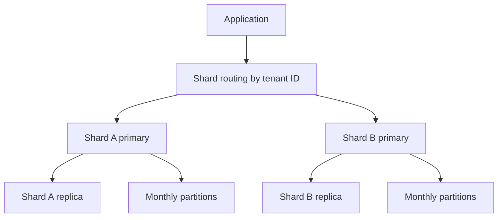

**Decision tree: start from a measured bottleneck, not a fashionable technology.**

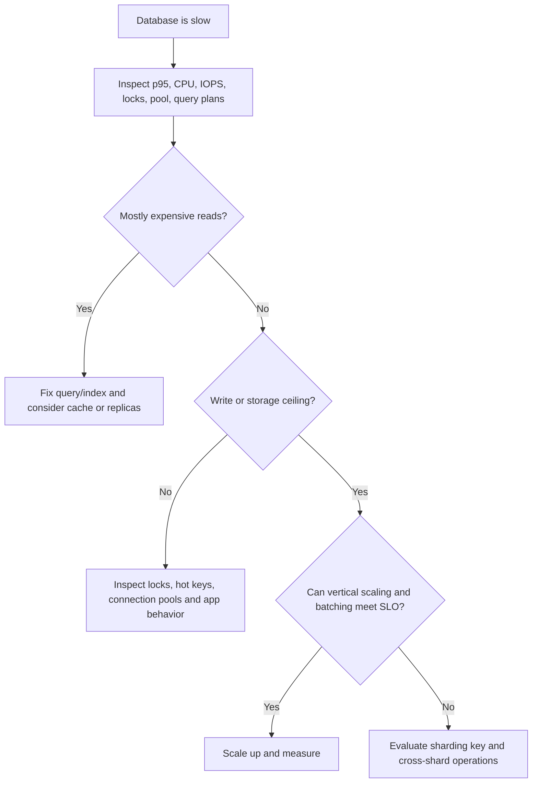

**Shard key exercise:** Tenant ID keeps tenant-local transactions together but a giant tenant can become a hotspot. Hashing `(tenantId, entityId)` spreads load but makes tenant-wide reports scatter/gather. Time-based ranges simplify retention but risk hot recent partitions. Model query patterns, distribution, skew, migration, and how shard routing metadata is updated. `hash(key) % N` is easy to teach but reshuffles many keys when N changes; virtual shards or routing maps ease rebalancing.

**Replication consistency:** A read replica may be stale. If a user must see their just-committed write, route that read to the leader or use session/causal tokens where supported. A failover is not automatically lossless: define acknowledgment quorum, RPO (acceptable data loss), and RTO (recovery time). Synchronous replication may increase write latency or sacrifice availability when replicas fail.

**Interview answer:** “I would first compare CPU, disk, locks, query plans, read/write mix, and hot tenants against the SLO. I'd optimize queries and indexes, consider replicas for reads, and shard only if the primary's write/storage ceiling remains. Before sharding I'd quantify cross-tenant queries, key skew, transaction boundaries, and the rebalancing plan.”

### 6A.2 Service and API boundary decisions

| Choice | Strength | Cost / caution |
|---|---|---|
| Modular monolith | Simple transactions, deployment, debugging | Shared release and scaling boundary |
| Microservices | Independent scaling/ownership and releases | Network failures, distributed data ownership, tracing |
| REST/HTTP | Broad tooling, resource semantics, caches | Loose schema discipline unless enforced |
| gRPC | Typed Protobuf contracts, streaming, efficient binary encoding | Proxy/browser interoperability, debugging, versioning |
| GraphQL | Client-shaped reads and aggregation | N+1, query cost limits, authorization complexity |
| Async event | Decoupled consumers and latency isolation | Eventual consistency, duplication, ordering, schema evolution |

Before creating a service, ask: Does it have a clear domain owner? Independent scaling or deployment need? Separate data ownership? A stable contract? A team that can operate it? Prefer synchronous calls for immediate answers when latency and availability permit; events for facts consumed independently. Version APIs and events with additive evolution, consumer-driven contract tests, and explicit deprecation windows. **Authentication** establishes identity; **authorization** checks permitted action and resource, including tenant isolation.

### 6A.3 Capacity and cost estimation worked example

Assume (hypothetically) 20,000 active tenants, 100 exports/day each, average 5 MB per output, with 10x peak arrival rate. Average export arrival rate is 2,000,000 / 86,400 ≈ 23.1 jobs/s; peak ≈ 231 jobs/s. If each export consumes 3 worker-seconds, steady peak demand is ≈ 693 concurrent worker-seconds per second, or roughly 693 fully occupied workers absent batching and other bottlenecks. Storage generated ≈ 10 TB/day before compression, replication, and retention. **Check assumptions:** real tenant activity distribution, job-size tail, CPU vs I/O time, retries, egress cost, and tenant-level burstiness. Use Little's Law, `L = λW`, for average work in system; do not confuse arrival rate with throughput capacity.

## 6B. Failure-Driven Design: Export Pipeline From Naive to Reliable

### 6B.1 State machine and invariants

Invariants: an accepted job has durable tracking state; the same client idempotency key maps to one logical request; duplicate deliveries cannot publish multiple conflicting final artifacts; each job has an auditable terminal outcome or remains recoverable; tenants have bounded concurrency. These are design goals requiring enforcement, not properties conferred by SQS alone.

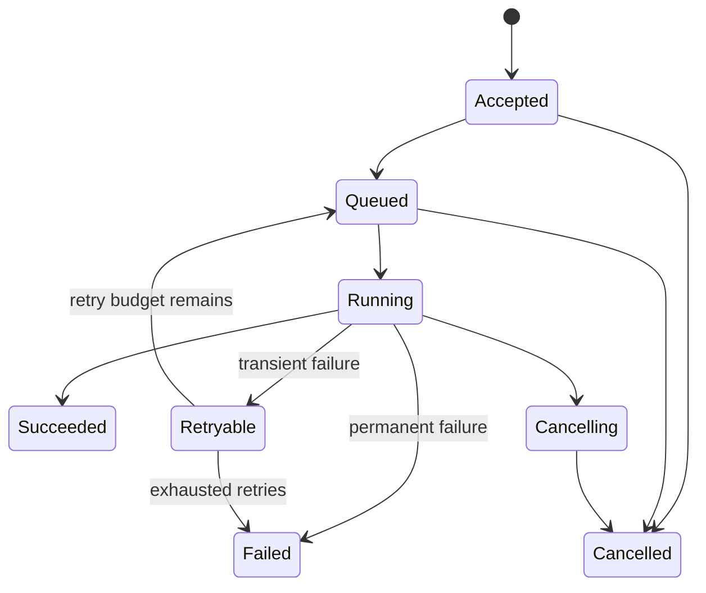

### 6B.2 Failure windows

**Naive design:** API commits `jobs(status=QUEUED)`, then publishes to broker. If the process crashes between steps, the job is stranded. Reverse the order and a worker can receive a message for a job that never committed.

**Outbox design:** In one local transaction, insert the job and an outbox event. A relay polls or uses CDC, publishes, then marks the outbox item sent. If it crashes after publish but before marking, it publishes again; consumer idempotency is mandatory.

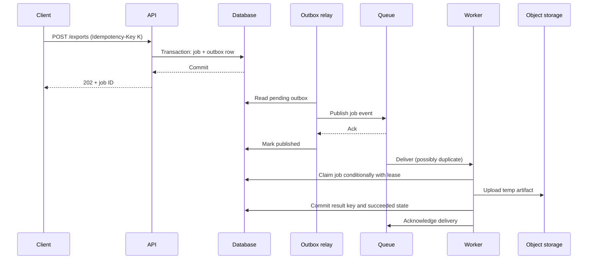

**Worker crash:** A lease expires; a new worker can reclaim the job. Use conditional state transitions or fencing tokens so an old worker cannot overwrite the newer attempt. **S3/object storage:** Upload to a unique temporary key and only expose the artifact after atomic database status transition; cleanup abandoned objects. **Timeout:** A storage or ERP timeout is UNKNOWN, not failed; query status or retry with a stable idempotency key. **Cancellation:** Specify whether cancellation is best effort and what happens if publication already occurred. **Schema migration:** Deploy backward-compatible producers and consumers before changing event payloads.

```sql
-- Illustrative PostgreSQL transaction: unique tenant + idempotency key
BEGIN;
INSERT INTO export_jobs (id, tenant_id, idempotency_key, status)
VALUES (:job_id, :tenant_id, :key, 'ACCEPTED')
ON CONFLICT (tenant_id, idempotency_key) DO NOTHING;
-- Only the creator should insert the outbox row; resolve existing key
-- and compare request payload hash before returning an existing job.
INSERT INTO outbox_events (event_id, aggregate_id, type, payload)
VALUES (:event_id, :job_id, 'ExportRequested', :payload);
COMMIT;
```

**Important:** The snippet illustrates transaction grouping, not a complete correct endpoint: if the first insert conflicts, the outbox insert must be skipped. A production implementation uses a CTE/returning row or application transaction branch, checks a request hash, and returns the existing job safely.

**Fairness:** Per-tenant concurrency tokens or scheduler queues prevent one large tenant from monopolizing workers. SQS FIFO message groups can serialize work per group but are not a complete global fair scheduler. Track queue age, oldest job, retries, dead-letter queue volume, per-tenant completion latency, and worker saturation.

**Failure injection drills:** Kill the API after DB commit; kill the relay after publish; deliver the same message twice; kill a worker mid-upload; block the object store; expire a worker lease; deploy a mixed old/new schema. For each, predict durable state and recovery path before running the test.

## 6C. Operational Diagnostics and SLOs

### 6C.1 What to measure

**RED** (request rate, error rate, duration) measures request-serving services. **USE** (utilization, saturation, errors) measures constrained resources such as CPU, disk, memory, and pools. Use trace IDs across gateway → API → broker → worker → datastore; propagate tenant and job IDs without leaking sensitive data. Compare p50/p95/p99; averages conceal tail latency. An SLO such as 99.9% successful exports over 30 days has an error budget of 0.1% of eligible requests; define exactly which requests count.

| Symptom | Distinguishing evidence | First hypotheses |
|---|---|---|
| Rising p99, stable p50 | Trace spans, lock waits, GC pauses | Tail contention, cold partitions, slow dependencies |
| High queue age | Enqueue/consume timestamps, worker occupancy | Arrival rate exceeds processing, poison jobs, fairness |
| Browser hangs on stream | Chunk timestamps at each hop | Proxy buffering, idle timeout, client parsing |
| DB CPU high | EXPLAIN ANALYZE, scans, cache hit ratio | Query plan regression, missing indexes |
| Connection exhaustion | Pool metrics, `ss -tan`, DB session counts | Leaks, insufficient pooling, long transactions |

### 6C.2 `/pull` troubleshooting playbook

1. Reproduce with one affected user and capture timestamps, request ID, browser Network waterfall, and expected update version.
2. `dig +trace example.com` checks authoritative DNS delegation; compare `dig example.com` against configured resolver. `curl -v --http2 https://host/pull` exposes DNS, TCP, TLS/ALPN and response headers (authentication may be required). `curl -N` disables client-side output buffering for streaming tests.
3. Compare time-to-first-byte and chunk arrival timestamps **before and after** the enterprise proxy and ingress. A 200 response does not prove timely streaming delivery.
4. Inspect gateway idle timeout, buffering, response compression, HTTP version conversion, heartbeat framing, and service cancellation propagation.
5. On an authorized host, `ss -tanp` shows socket states; `tcpdump -i eth0 host <ip> and port 443` captures packets, but TLS payload is encrypted. Prefer controlled captures and protect secrets.
6. Correlate service logs with event publish/subscribe, version checkpoints, reconnect tokens, and client reducer updates. Test disconnect/reconnect and replay window expiry.

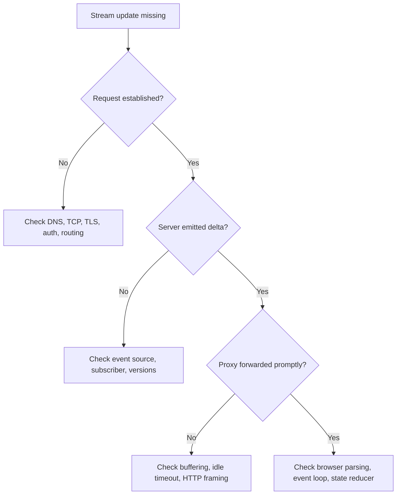

**Nuance:** A proxy can buffer a stream even when the TCP connection is healthy; an idle firewall can silently drop state; TCP keepalives do not necessarily replace application heartbeats. HTTP/2 does not use HTTP/1.1 chunked transfer encoding. QUIC avoids TCP-style cross-stream head-of-line delivery blocking but still shares connection-level congestion control.

## 6D. Frontend Architecture: State, Workers, and Evidence

**State ownership:** Local visual state stays in components; shareable filters live in URL state; fetched server state belongs to a query cache; authoritative edits belong to backend contracts; a Worker-backed SQLite projection is derived state, not automatically the source of truth. MFEs should communicate through explicit versioned shell/API/event contracts, not import each other's internal Redux state.

**Worker result ordering:** Every query carries `{requestId, datasetVersion, filterVersion}`. If the user changes a filter while a slow query runs, the main thread ignores stale results rather than rendering old rows. Cancellation is an optimization; version checks are correctness. If using `useSyncExternalStore`, `getSnapshot` must return a cached stable reference until the store changes, and subscriptions must notify after a coherent snapshot is published.

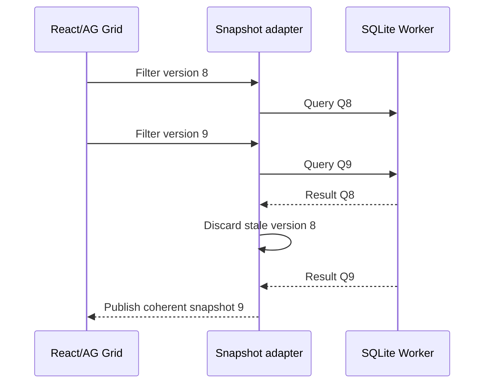

**Performance experiment:** Define user-perceived latency (keystroke → painted grid), main-thread long tasks, memory peak, Worker initialization, transfer cost, and p95 query time. Compare representative datasets (1k/10k/100k rows) on low-end and high-end hardware. React transitions prioritize rendering work but do not make a synchronous expensive SQL call on the main thread asynchronous. Virtualization reduces DOM cost, not query or formula complexity. SSR helps initial content delivery but hydration adds client work; choose CSR/SSR/hybrid by interaction, SEO, caching, and operational requirements. Accessibility needs keyboard navigation, focus preservation across virtualized rows, screen reader semantics, and reduced-motion behavior.

## 6E. AI Evaluation and Governance: From Demonstration to Outcome

Treat research as **context-bound evidence**: record study population, task types, tools, baseline, outcome definition, confidence interval, and publication date. A reported 55% improvement in one controlled coding experiment and a 19% slowdown in a different mature-codebase experiment cannot be combined into a universal productivity rule. Test in your own workflow.

**Evaluation design:** Randomize eligible tasks or use a matched crossover design; pre-register primary metrics (lead time, accepted change rate, escaped defects), guardrails (security findings, review time), and segmentation (new code vs legacy, novice vs expert, task complexity). Measure the entire change lifecycle, not code generation alone. Review privacy, data residency, retention, prompt injection, authorization, and model/version drift. Deterministic checks reduce risk but do not prove business correctness; human accountability and rollback remain necessary.

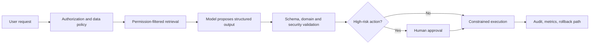

## 6F. Staff-Level Delivery: An Executable Decision Framework

Use the following sequence for architecture interviews and actual RFCs:

1. **Problem and boundaries:** Who is affected? What must work? What is explicitly out of scope?
2. **Invariants and SLOs:** What must never be lost, duplicated, exposed, or delayed beyond target?
3. **Evidence and assumptions:** What is measured? What is hypothetical? What are the workload distributions?
4. **Options:** Include a simple baseline, incremental option, and ambitious option; compare correctness, cost, complexity, and time.
5. **Failure and migration:** Show timeout ambiguity, partial rollout, mixed versions, backfill, rollback, and on-call ownership.
6. **Delivery plan:** Dependencies, critical path, scope cuts that preserve invariants, release gates, and owner for each risk.
7. **Post-launch proof:** Instrument metrics, define review date, and record who decides whether to expand or revert.

**Example interview follow-up:** “Why shard now?” Weak: “Because we have millions of rows.” Strong: “We have measured sustained primary write saturation after index and batching improvements. Our tenant-local transactions favor tenant sharding, but the top tenant accounts for 30% of writes, so I would load-test hotspot handling and quantify scatter/gather reporting costs before migration. We'd canary routing, dual-verify reads, and retain rollback until writes have safely cut over.” All figures here are illustrative.

**Migration checklist:** backward-compatible schema; mixed-version tests; idempotent backfill; dual-read/write reconciliation if required; rollout flag; dashboards; reversible routing; explicit point of no return; tested recovery runbook. A database migration can make code rollback unsafe if old binaries cannot read new data.

**Podcast active-recall prompts:** Explain partitioning vs sharding vs replication; trace an outbox duplicate; diagnose a stalled stream hop-by-hop; explain why `useSyncExternalStore` does not solve Worker synchronization; justify when not to use an LLM; and give a two-minute ADR defense with a rollback plan.


## 7. Quick Reference, CLI Cheatsheet & Master Concept Maps

### 7.1 System Architecture Master Concept Map

```mermaid
flowchart TB
    subgraph EdgeLayer["Edge & Traffic Routing"]
        DNS["DNS / Anycast"] --> EdgeWAF["CDN / Edge WAF / TLS Termination"]
        EdgeWAF --> L7LB["L7 Load Balancer / Ingress Gateway"]
    end

    subgraph AppLayer["Application & Micro-Frontend Services"]
        L7LB --> NodeAPI["Node.js / Express Domain APIs"]
        ReactMFE["React Micro-Frontends (AG Grid + Web Worker)"] -->|API requests| L7LB
    end

    subgraph StorageLayer["Persistence & Messaging Tier"]
        NodeAPI --> Mongo[(MongoDB Domain Collections)]
        NodeAPI --> MySQL[(MySQL Relational Policies)]
        NodeAPI --> Outbox[(Transactional Outbox)]
        Outbox --> SQS["AWS SQS (Durable Job Queues)"]
        Outbox --> Kafka["Apache Kafka (Event Stream Log)"]
        NodeAPI --> S3[(S3 Immutable Object Store)]
    end

    subgraph AsyncLayer["Background Workers & AI Platform"]
        SQS --> Workers["Node / Python Background Workers"]
        Kafka --> Analytics[(Snowflake / Redshift Analytics)]
        Workers --> RAG["Governed RAG AI Platform"]
        RAG --> HumanGate{"Human Approval Gate"}
        HumanGate -->|Approved| NodeAPI
    end
```

---

### 7.2 Core Technical Terminology Glossary

*   **At-Least-Once Delivery**: Messaging guarantee where messages are delivered one or more times; consumers must enforce idempotency to prevent duplicate side effects.
*   **Circuit Breaker**: An operational pattern that halts downstream calls after a threshold of consecutive failures, returning immediate fallback responses to allow failing services to recover.
*   **Head-of-Line (HOL) Blocking**: A performance bottleneck where a stalled or dropped byte packet delays delivery of subsequent queued messages or stream segments.
*   **Idempotency Key**: A unique client-generated request identifier used by server endpoints to detect, deduplicate, and return cached outcomes for retried requests.
*   **Mutually Authenticated TLS (mTLS)**: A security protocol where both client and server validate each other's X.509 digital certificates to establish encrypted, identity-verified transport.
*   **Operational Transformation (OT)**: An algorithmic framework for real-time collaborative editing that transforms concurrent operation parameters to maintain document convergence.
*   **Reconciliation Engine**: A background process that compares independent datasets (e.g., internal ledgers vs payment gateway logs) to identify and flag discrepancies.
*   **Retrieval-Augmented Generation (RAG)**: An AI architecture that retrieves contextually relevant, authorized domain records from an external store to ground generative model responses.
*   **Transactional Outbox**: Writes domain changes and publication intent in one local transaction. A reliable relay can eventually publish committed events, often more than once; consumers still need idempotency, and relay health must be monitored.
*   **Write Skew**: A concurrency anomaly under Snapshot Isolation where two parallel transactions read overlapping data, perform mutually contradictory writes, and commit successfully while violating a global systemic invariant.


